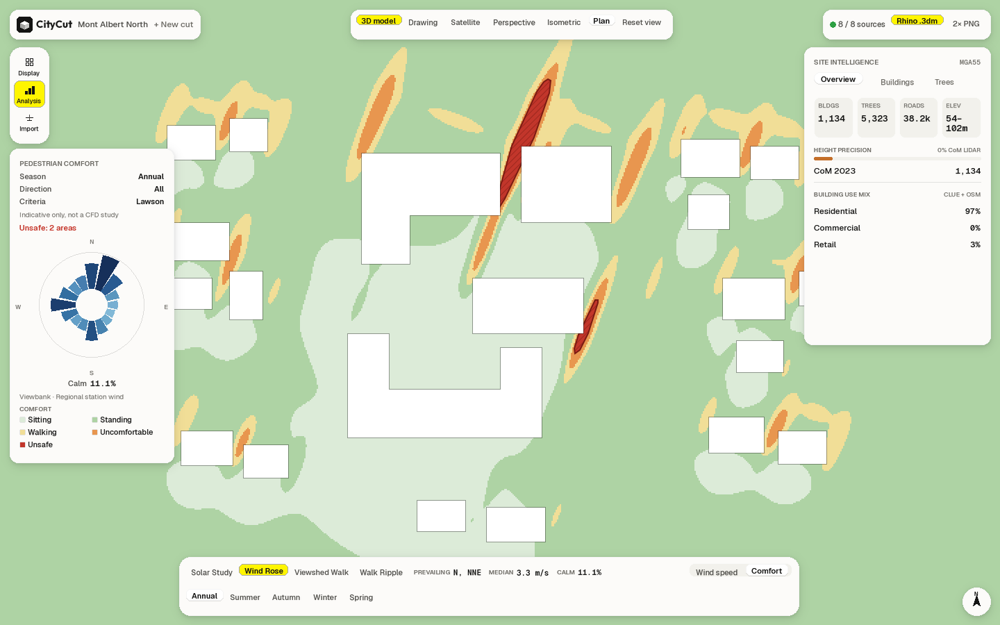

# Feature: Plan wind diagrams (Wind speed + Pedestrian comfort)

## What it does

In Plan view with Wind Rose on, the ground becomes a top-down wind diagram. A **Wind speed | Comfort** switch in the bottom wind console flips between a velocity map in m/s for one season and direction, and a Lawson-style pedestrian comfort map that combines every direction in the season. Both reuse the wind data and flow model from the 3D wind draft (#232). They are indicative only, not a CFD study.

## What it looks like

Screens this touches: Plan view of the 3D model with Analysis → Wind Rose on; the wind-rose card (left); the floating Velocity and Comfort legend cards (lower right); the bottom wind console; Site Intelligence (right, collapse only).

Sketch or screenshot (Paper mock-ups v2, approved by Designbot on 17 Nov 2026):

The 1024 mock-ups are on the shared computer at `/workspace/wind-plan-mock/v2-speed-1024.png` and `v2-comfort-1024.png`. Wind speed tweaks on top of the mock-ups: a larger clickable rose in the Plan wind card, and no wind arrow on the map. Comfort no longer follows the mock-up: since 19 Nov 2026 it follows Kelvin's Lawson reference (White Bay / Rozelle comfort map, `/workspace/comfort-restyle/kelvin-reference.png`), described under Comfort below.

### Wind speed
- The ground shows a smooth velocity field in m/s: the #232 speed-ratio field for the heading, times the season's reference speed for that direction. The scale is fitted to each site (see the 18 Nov call below): its top is a round number at or above the 99.5th percentile of the walking-height speeds the map paints over open ground (building cells left out) in any of the site's views (Annual, Summer, Autumn, Winter, Spring and its three design winds). Building and water cells are left out, so a windy bay cannot lift the top; land near the shore, with its quiet shore boost, still counts. A percentile, not the single fastest cell, so one tight corner speed-up cannot lift the top a whole step. The top is cached by a fingerprint of the obstacle, tree and water geometry the map is drawn from: the same complete site always gets the same top, and a site loaded with fewer sources never reuses it. Peaks up to 4 m/s give 4; from 4 to 6 m/s the top rounds up to the next whole m/s (5 or 6); above 6 m/s it rounds up to the next even number (8, 10, 12…). Switching season or design wind at one site keeps the same scale so the maps compare; picking any of the 16 directions on the rose never changes it, and a heading that runs past the top takes the top colour. The scale is worked out once per site before the first Wind speed map is coloured, so it never flashes 0–4 first; Comfort does not wait for it.
- Styled like Kelvin's CFD reference: a smooth continuous colour field (the speed field is bilinear-sampled onto an image about 4× the grid before colouring, so there are no colour steps), fine grey isolines across the whole field, and deep-blue sheltered wakes. The plan has its own ramp (`--wind-plan-speed-*`, linear between stops), set out on 0–4 m/s: 0 m/s deep royal blue, 1 m/s mid blue, 2 m/s cyan, 2.8 m/s green-yellow, 3.5 m/s yellow, 4 m/s orange-red. On a taller site scale the stops stretch in proportion (each stop × top / 4; at a top of 8: 0, 2, 4, 5.6, 7, 8 m/s), so mid-scale stays cyan and only the top of that site's range goes yellow or orange-red. On a 0–4 m/s site typical lee-side wakes (about 0.8–1.5 m/s) stay deep to mid blue. The 3D streaks keep the #232 ramp.
- Pedestrian height: the Viewbank TMYx speeds are measured at 10 m in open terrain, so they are brought down to 1.5 m with a power-law profile, suburban exponent α = 0.25 (factor (1.5/10)^0.25 ≈ 0.62), before multiplying by the speed-ratio field. The card's Reference row shows this corrected speed; the console median stays the station value.
- The map is smoothed for display only (Gaussian, about 6 m) so it reads as flow shaped by buildings, not speckle. Contours use the same smoothed field; comfort classes use the unsmoothed one.
- Cells near the cut edge are computed with the cut's buildings wrapped round its edges (a periodic boundary), so the edge sees built-up ground upwind and downwind like the rest of the site rather than open land. Nothing outside the cut is drawn.
- Wakes (low speed) sit on the lee side of each building and move when the season or direction changes. Since Kelvin's 19 Nov 2026 call they run to about 4H (up to 240 m), ease off downwind and widen slowly into tapered sheltered streaks. Each building's two windward corners have a clear speed-up zone that runs along the side, and gaps and streets aligned with the wind channel faster than open ground. Trees keep a shorter wake. Wind speed uses the one heading picked (season direction, rose sector or design wind); Comfort combines every heading by its frequency.
- Water is not painted (Kelvin's call, 19 Nov 2026): the cut first shows the muted grey base map, as in Comfort, and the speed colour and isolines go on land only, so bays and rivers show as the base map's grey-blue water. Buildings over water still draw as footprints. Land within 60 m of water keeps a quiet shore boost, so streets at the water's edge can run a little faster than inland. The card no longer says "Faster over water".
- Imported models: wind treats every visible imported model as solid and removes map buildings underneath them (any footprint overlap drops the whole map building), plus trees whose crowns overlap them, so they are not counted twice. Moving, hiding or removing an import recomputes the field. The 3D ground-wind flow uses the same obstacle grid. Imported models are drawn on the wind maps in the same style as map buildings: white on Wind speed, light grey on Comfort. Map buildings under an import still draw on the wind maps, in the 3D view, plans and exports unless the user hides them. Hidden map buildings (Hide selected or a hidden use) are left out of the wind: the obstacle grid for the plan and the 3D flow.
- Preference: wind treats imported models as solid and removes map buildings underneath them (Kelvin's yes, 17 Nov 2026).
- Preference: imported models are drawn on the wind maps; hidden map buildings are left out of the wind (Kelvin's yes, 17 Nov 2026).
- Isolines from one step up to one step below the top: every 0.25 m/s at a top of 4, every 0.5 m/s at a top of 5–8, every 1 m/s at 10 or more. Uniform 0.75px mid grey (#5A5A5A) at 30% opacity, so they read as a fine mesh, not bold belts.
- The **Velocity (m/s)** legend sits inside the wind-rose card, in its footer below the rose and station lines (the slot the Lawson key uses in Comfort): the plan ramp as one left-to-right gradient (`linear-gradient(to right, …)`) on a bar about 8px tall with 2px corners across the card's content width, 0 at the left and the site's top at the right. Its colours and stop positions are exactly the map's (same tokens at 0, 25, 50, 70, 87.5 and 100% of the top), with about five 11px Geist Mono ticks under it: 0 1 2 3 4 at a top of 4, 0 2 4 6 at 6, 0 2 4 6 8 at 8, 0 2 4 6 8 10 at 10. Ticks stay hidden until the site's scale is known. There is no separate velocity card on the map.
- Kelvin's call, 18 Nov 2026: the velocity legend lives inside the wind rose / Plan wind card; there is no separate right-side velocity card.
- There is no separate info card on the map: the Plan wind card already shows the reference speed, direction and season or design wind. The small top-left Wind speed / Direction / Season card was removed (Kelvin, 18 Nov 2026).
- Kelvin's call, 17 Nov 2026: keep the pedestrian-height correction. His call that day for a fixed 0–4 m/s scale is replaced by the 18 Nov call.
- Kelvin's call, 18 Nov 2026: fit the speed scale to each site's winds, minimum top 4 m/s, the same scale across that site's season and design-wind views, keeping the CFD look (smooth field, fine isolines, Velocity (m/s) legend). Comfort stays on the fixed Lawson thresholds.
- Preference: speed map styled like CFD reference: smooth field, fine isolines, a velocity legend (Kelvin's yes, 17 Nov 2026); the legend moved into the wind-rose card on 18 Nov 2026.
- Direction defaults to the season's prevailing direction. It is picked on the rose in the Plan wind card (see "Clickable rose" below); the card's Direction row is a read-out in the form `NE · 45°`, for a season, Annual and a design wind alike.
- There is **no single on-map wind arrow** and no "Wind from X" chip in any plan wind view, Wind speed or Comfort, and the 3D view has none. Direction is shown in the Plan wind card and on the rose. Kelvin's call, 18–19 Nov 2026 (it replaces the 18 Nov "Wind from X" arrow label). The flow vector grid below is a different thing: many small arrows showing the local flow, not one direction label.

### Flow vector arrows (Kelvin's call, 19 Nov 2026, 10:47 AM AEDT)
- Both plan maps, Wind speed and Comfort, carry a regular grid of small, thin, dark arrows over the colour field, like Kelvin's CFD reference (`/workspace/comfort-restyle/kelvin-arrows-reference.png`).
- Kelvin picked the diagonal grid at 12:37 PM AEDT on 19 Nov 2026, then at 12:55 PM asked for wider spacing, longer arrows and smaller heads: black arrows (`#1A1A1A` at 70%), a staggered/diamond lattice at 22 m (every other row offset by 11 m), 2px head, 1px shaft, land only. Arrows stay put when panning. When zoomed out so far that neighbours sit closer than 7px on screen, every second (then fourth…) row and column is dropped, still on the same lattice. The 7px floor keeps the 22 m grid visible at the usual 1–1.5 km plan view; further zoom-out still thins, so it does not turn into noise.
- Direction follows the local flow from the same per-heading field as the wakes, corners and channels (lightly smoothed), so arrows bend around buildings, slow in front of windward faces and run along streets. Wind speed and a picked rose sector or design wind use that one heading. Comfort uses a frequency-weighted vector sum of every heading's flow, weighted by each direction's share of the season's wind times its mean station speed (the same season weights that build Comfort), so its arrows show the season's mean local flow and still deflect around buildings.
- Length scales with the walking-height speed at the arrow: in Wind speed against the site's speed-scale top, in Comfort against the 99.5th percentile of the season's mean walking-height speed on painted land. The calmest arrows are 72% of full length so wakes still read as short lines, and the fastest are capped at 18px and at 88% of the on-screen 22 m pitch so a small gap remains and neighbours never touch.
- Shaft and head are sized in screen pixels (1px shaft, 2px head strokes, `#1A1A1A` at 70% via `--wind-plan-vector-*` in `src/drawing-style.css`). Length is taken from the 22 m lattice pitch, not from the 11 m row offset. At the usual 1.5 km plan view a mid-speed shaft is about 9 px (the 15 m grid’s measured median was 4.12 px) and the full-strength cap is about 10.5 px, leaving a small gap to the next arrow. So they read as lines when zoomed out and stay delicate when zoomed in.
- Arrows draw after the colour fill and under the building footprints, clipped to land: none on buildings, none on water, and no arrow is placed within 4 m of either. In Comfort they also stay inside the site clip, like the fill.
- An **Arrows** toggle sits next to the Wind speed | Comfort switch in the console, in the same white raised switch style (`aria-pressed`). Default on. Off hides every arrow and leaves both colour maps unchanged.
- Still indicative, not CFD: the arrows show the rule-based flow model's direction, not a solved velocity field.

### Clickable rose (Designbot spec, approved by Kelvin 18 Nov 2026)
- The ‹ N › stepper is gone. In Wind speed the rose in the Plan wind card is the direction picker. In Comfort it is a plain chart and Direction reads "All". The rose elsewhere (outside plan views) is not interactive.
- Each of the 16 sectors is a click target: the full 22.5° sector out to the outer ring, empty sectors included. Clicking one analyses that direction for the current season or Annual. If a design wind is active, clicking a sector leaves the design wind and shows that direction for the current season or Annual.
- Hover: the hovered petal goes to full opacity with a 1.5px ink outline; the other 15 fade to 45%; pointer cursor; 120ms ease-out fade, no transition under reduced motion. A tooltip is pinned to the outer ring at the middle of the hovered sector (not following the cursor), 11px: `NE · 18% of hours · 3.9 m/s median` — the 16-point label, that direction's share of all hours (the same basis as the design-wind share), and the walking-height speed the map uses for that direction in the current period, one decimal.
- Selected: a 22.5° arc on the outer ring, 4px thick, accent yellow with a 1px ink edge; that direction's 16-point label drawn and bold at the ring (N, NE, SSW…); the selected petal keeps a 1px ink outline when not hovered. Selection is never colour-only.
- Keyboard: the rose takes focus (tab stop, not hidden from assistive tech) and shows a 2px ink focus ring with a 2px offset. Left and Right step the analysed direction one sector at once (and leave a design wind, as a click does). Enter selects the hovered sector, or confirms the selected one.
- Hover, selected and hit-target styles are class names (`wind-rose-petal`, `is-hovered`, `is-selected`, `wind-rose-hit`, `wind-rose-selected-arc`, `wind-rose-tip`) so they can be restyled later.

### Rose polish (Kelvin and Designbot review, 19 Nov 2026)
These replace the hover tooltip, selected mark and guide-label details above where they differ.
- Hover dimming must be obvious: while the pointer is over any sector the other 15 petals sit at opacity 0.45 (120ms ease-out, no transition under reduced motion) and come back when the pointer leaves the rose. Each sector's hit target lives inside that sector's petal group, so the dimming works from CSS `:hover` and from the `is-hovered` / `data-hovering` state (kept for tests and keyboard). Labels and the selected arc never take the pointer.
- Selected mark: a circular arc stroke centred on the outer ring (radius R), exactly 22.5° (sector centre ± 11.25°), 4px, butt caps, accent yellow, with a 1px ink edge all round (a 6px ink arc under it, 1px longer at each end). Not a filled tab with radial sides. The bold selected label sits at R+14 along the sector bearing, centred, N/E/S/W included.
- The 33% and 66% guide labels sit on the rose's least-used bearing, worked out again for each period, at the matching guide-ring radii: 9px, muted text, on a 2px card-surface plate so they read over the guides (a plate, not a text outline).
- Tooltip: pinned outside the ring, 8px past R along the sector bearing, growing away from the rose. It keeps clear of the N/E/S/W labels and flips to the other side if it would run off the screen. Copy follows the map: on the active design wind's own sector it shows the design-wind figures (`NE · 18% of hours · 3.9 m/s`); otherwise the period comes first (`NE · Annual · 7% of hours · 4.1 m/s`). The word "median" is not used: the speed is the walking-height reference the map uses, not a median.
- In the Plan wind card the station block under Calm is 11px muted text, and the closer stations sit behind a "Nearby stations" disclosure, closed by default, listing each station with its unbreakable distance (`7.9 km`). The rose outside plan views keeps its plain "Closer:" line.

### Comfort (Lawson LDDC, indicative)
- For each ground cell, every direction in the season is weighted by its frequency (from the Viewbank TMYx speed bins) and combined with that direction's speed-ratio field to get how often each threshold is exceeded.
- The station speeds get the same 10 m to 1.5 m pedestrian-height correction as Wind speed (power law, α = 0.25, factor ≈ 0.62) before the thresholds are tested.
- Water is not rated (Kelvin's call, 19 Nov 2026): inside the site clip the comfort bands and Unsafe hatching are painted on land only, water shows as the grey base map, and water cells never count towards "Unsafe: N areas". The per-heading fields carry the same longer wakes, windward-corner speed-ups and channelling as Wind speed.
- Above the top station bin (40 km/h and over, open-ended) each direction's speeds follow a Weibull curve fitted to that direction's own bins, as wind climates are usually described for comfort studies (NEN 8100). Before 19 Nov 2026 the tail was a fixed exponential guess one bin wide, which made the 15 m/s test fail on open ground at windy stations: at Sydney Airport (White Bay, Pyrmont) open ground came out at 0.04% of the year against the 0.022% limit, so nearly the whole map was flagged Unsafe. The fitted curves come out close to the textbook shape for wind (k ≈ 2) and put that open ground near 0%; strong corner and gap speed-ups at exposed sites can still be Unsafe. The thresholds did not change. Directions with too few bins to fit keep the old exponential tail.
- Criteria: Lawson LDDC, with comfort and safety as in the City of London *Wind Microclimate Guidelines* (2019). Comfort uses mean-hourly speeds exceeded no more than 5% of the time, in five bands: Sitting ≤ 4 m/s, Standing ≤ 6 m/s, Strolling ≤ 8 m/s (the LDDC leisure-walking band), Walking ≤ 10 m/s, Uncomfortable above that.
- Unsafe is a safety flag, not a sixth comfort colour: more than 15 m/s for more than 0.022% of the year (about 2 hours). An unsafe patch keeps its comfort-band colour and gains a 45° hatch (1px #7A1A12 at 6px spacing) and a 2px #7A1A12 outline; patches smaller than 12px are drawn as a 12px hatched, outlined disc. All of it stays inside the site clip.
- Styled like Kelvin's Lawson reference (Kelvin's call, 19 Nov 2026):
  - Five Lawson colours, sampled from the reference legend: Sitting #BDF8DA, Standing #6ADCA0, Strolling #F8D404, Walking #FAA902, Uncomfortable #F44333.
  - A smooth, fully opaque filled field: Sitting as the base, then each higher band as a smooth vector contour with clean edges. No grid cells and no isolines.
  - The field is clipped to the site parcel and the parcel is drawn as a dashed red site boundary (#D7263D, the same dash and weight as other CityCut site outlines). Where there is no parcel (for example NSW cuts with no Vicmap parcel), the clip and the dashed outline fall back to the cut rectangle.
  - Inside the cut but outside the site: a muted grey base map (#F3F3F3) with soft grey roads, grey-blue water and grey-green parks. No map tiles, street labels or wind roses.
  - Buildings are light grey (#C5C5C5) with the same light ink edge, inside and outside the site.
  - A boxed Comfort legend card (see Panels).
- The four time-of-day wind roses in the reference are left out for now.
- The card shows "Unsafe: N areas" or "Unsafe: none". Direction reads "All".
- Preference: comfort map styled like the reference: five Lawson colours (Sitting, Standing, Strolling, Walking, Uncomfortable), smooth opaque fill, clipped to a dashed red site boundary (cut fallback when no parcel), muted grey base map with light-grey buildings, boxed HUD legend (Kelvin's yes, 19 Nov 2026).

### Panels and console
- The plan rows (Season, Direction, Reference in m/s or Criteria "Lawson", "Indicative only, not a CFD study") sit at the top of the existing wind-rose card, with "Unsafe: N areas" in Comfort. The card has no comfort swatches. In Wind speed the card footer holds the horizontal Velocity (m/s) bar and ticks. The card is 272px wide with 16px padding, and the rose fills the 240px content width (up from 160px in a 236px card with 12px padding; Designbot, 18 Nov 2026). The card stays at least 8px clear of the bottom console, the left rail and the compass, and scrolls rather than covering the console when space runs short. At 1280 wide or less the console starts 8px right of the 272px card.
- The "Closer:" station line is 12px/500 and wraps only between stations; each distance ("7.9 km") is one unbreakable unit, never clipped or split, and the line is not clamped. Its tooltip keeps the full single-line text.
- In Comfort the legend is its own floating card in the lower-right corner: the usual HUD card surface, border, shadow and 12px corners, a "COMFORT" title (10px/700 uppercase, ink-3), then one column of five rows (Sitting, Standing, Strolling, Walking, Uncomfortable), each a 20×12px swatch with a faint 1px edge, an 8px gap and a 12px/500 ink label. No Unsafe row. It stays at least 8px clear of Site Intelligence, the bottom console, the compass and the wind-rose card at 1024–1440, moving left of Site Intelligence if that panel runs long.
- The switch uses the white raised sub-option style. Wind Rose stays the one yellow active.
- Plan wind views use m/s only (no km/h in the console) and the console has no DIR readout.
- Buildings have a 1px #1A1A1A edge at 40% opacity: white footprints on Wind speed, light grey on Comfort. Tree dots are hidden in wind plan views.
- At 1280 wide or less, Site Intelligence collapses to its header while a wind plan is showing.
- Colours come from tokens only (DESIGN-SYSTEM.md); any deviation is listed in the PR body.

## How we'll know it works

- [ ] Plan view + Wind Rose shows the Wind speed | Comfort switch in the console, white raised style, with Wind Rose the only yellow active.
- [ ] Wind speed: smooth CFD-style field (deep blue, cyan, yellow, orange) on the site's own scale (0–4 m/s at Mont Albert North, taller at Pyrmont, the same across its seasons and design winds) with no colour steps; deep-blue wakes on the lee side of buildings that flip when the season or direction changes; fine grey isolines (0.25 m/s on a 0–4 scale).
- [ ] Wind speed: one left-to-right Velocity (m/s) gradient matching the map ramp, with ticks, in the wind-rose card footer; no separate velocity card and no top-left info card.
- [ ] No single wind arrow or "Wind from X" chip on the map in any plan wind view.
- [ ] Both plan maps show a 22 m staggered diagrid of thin dark arrows on land only (none on buildings or water, Comfort ones inside the site), bending around buildings, shorter in wakes and longer on corners and in streets; they keep a 1px shaft and a 2px head when zoomed in or out.
- [ ] Wind speed arrows turn with the picked heading; Comfort arrows show the season's frequency-weighted mean flow.
- [ ] An "Arrows" toggle beside the Wind speed | Comfort switch, on by default; off hides every arrow and leaves the colours unchanged.
- [ ] The same complete site always shows the same scale top; one fast cell does not lift it from 8 to 10.
- [ ] Clicking any of the 16 rose sectors (empty ones too) sets the direction; clicking while a design wind is active switches to that direction for the current season. Left/Right on the focused rose step it; Enter confirms. Direction reads e.g. `NE · 45°`.
- [ ] Rose hover: 1.5px ink outline, others visibly at 45%, 11px tooltip pinned outside the ring with share of hours and walking-height speed (period first unless it is the active design wind; no "median"). Selected: 4px yellow arc on the ring with an ink edge and a bold label at R+14. 33%/66% labels on the quietest bearing. Closer stations behind "Nearby stations".
- [ ] Comfort: five Lawson bands (Sitting, Standing, Strolling at 8 m/s, Walking, Uncomfortable) in the reference colours, as a smooth opaque fill with clean edges at 1440 and no isolines; Unsafe hatched and outlined over its band colour, at least 12px; the card reads "Unsafe: N areas" or "Unsafe: none"; Direction reads "All".
- [ ] Comfort: the fill stops at the site parcel, drawn as a dashed red site boundary; with no parcel it fills the cut and the dashed outline runs round the cut.
- [ ] Comfort: outside the site the cut shows a muted grey base map with light-grey buildings, grey roads, and soft water and park tones; no tiles or labels.
- [ ] Comfort: a boxed Comfort legend card in the lower right with five single-column rows and no Unsafe row; no swatches in the wind-rose card; at least 8px clear of every panel.
- [ ] A windy station (Sydney Airport, for example White Bay) no longer flags open ground as Unsafe; Unsafe stays limited to strong speed-ups.
- [ ] Water (Pyrmont's bays) is plain grey base map on Wind speed and Comfort, never a speed colour or comfort band, and never Unsafe; it does not lift the speed scale.
- [ ] Tall buildings leave long, tapered sheltered streaks on the lee side; windward corners and wind-aligned streets read faster than open ground on both maps.
- [ ] Plan rows sit inside the wind-rose card; in Wind speed the card footer shows the Velocity bar; in Comfort it does not.
- [ ] The "Closer:" line reads each distance whole ("7.9 km", never "79 km") and wraps between stations.
- [ ] Console shows m/s only in plan wind views, with no DIR readout.
- [ ] Buildings with a light ink edge, white on Wind speed and light grey on Comfort; no tree dots in wind plan views.
- [ ] At ≤1280 Site Intelligence collapses to its header; zero overlap and gaps of at least 8px at 1024, 1280 and 1440.
- [ ] Import a block: wind recomputes, the lee calms and the corners speed up; hiding or removing the import restores the previous field.
- [ ] Import a block: its footprint appears on both plan wind maps (white on Wind speed, light grey on Comfort) and updates when the import is moved, hidden or removed.
- [ ] Hiding a map building with Hide selected (or hiding its use) drops it from the wind field.
- [ ] Switching season, direction or mode feels instant (fields computed once and cached) and never moves the camera.
- [ ] Tests: lee-side wake (lower behind than upwind, still sheltered at 3H, flips with direction), windward corner and street channel faster than open ground, water unpainted and out of the scale and Unsafe count, Lawson thresholds including Strolling at 8 m/s, Weibull tail fit, comfort colours and legend order, site clip with cut fallback, unsafe-area count, frequency weights sum to 1.

## Out of scope

- A real CFD or wind-tunnel study and gust (GEM) speeds.
- Exporting the plan diagrams to PNG, .3dm or .ai.
- The four time-of-day wind roses from Kelvin's comfort reference (later).
- Changes to the 3D wind streak renderer from #232. The 3D flow does now use the import-aware obstacle grid.
- Auto-hiding map buildings under imports in the 3D view, plans or exports.
- Mobile layouts.

## Estimated runs

- 3 Claude Code runs (build, fix, polish), about 1 to 1.5 hours, then one screenshot to Kelvin.
