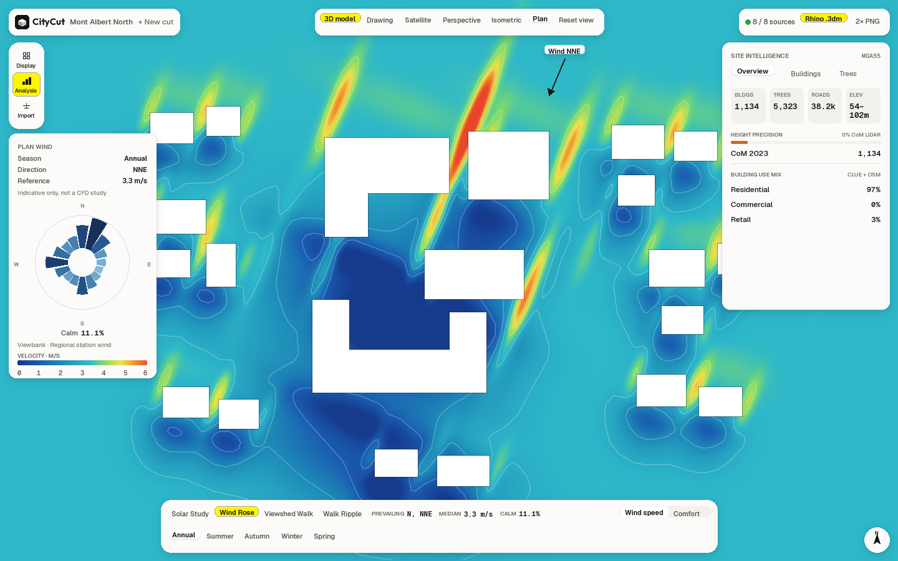

# Feature: Plan wind diagrams (Wind speed + Pedestrian comfort)

## What it does

In Plan view with Wind Rose on, the ground becomes a top-down wind diagram. A **Wind speed | Comfort** switch in the bottom wind console flips between a velocity map in m/s for one season and direction, and a Lawson-style pedestrian comfort map that combines every direction in the season. Both reuse the wind data and flow model from the 3D wind draft (#232). They are indicative only, not a CFD study.

## What it looks like

Screens this touches: Plan view of the 3D model with Analysis → Wind Rose on; the wind-rose card (left); the bottom wind console; Site Intelligence (right, collapse only).

Sketch or screenshot (Paper mock-ups v2, approved by Designbot on 17 Nov 2026):

The 1024 mock-ups are on the shared computer at `/workspace/wind-plan-mock/v2-speed-1024.png` and `v2-comfort-1024.png`. Three tweaks sit on top of the mock-ups: smooth comfort-band edges, Standing deepened to #9FCB94 with edged legend swatches, and the wind arrow at the upwind map edge.

### Wind speed
- The ground shows a smooth velocity field in m/s: the #232 speed-ratio field for the heading, times the season's reference speed for that direction. Colours use the #232 round 3 CFD ramp (blue sheltered, cyan, green, yellow, red), legend 0–6 m/s.
- Wakes (low speed) sit on the lee side of each building and move when the season or direction changes. Corners and gaps speed up.
- Contours only at 1, 2, 3, 4 and 5 m/s: 1px white at 35% opacity.
- Direction defaults to the season's prevailing direction and can be stepped through the 16 directions on the card. The wind arrow sits at the upwind map edge and rotates with the direction, at least 24px clear of any panel or building: 2px ink shaft, filled head, white label chip ("Wind NNE"), 11px/600.

### Comfort (Lawson LDDC, indicative)
- For each ground cell, every direction in the season is weighted by its frequency (from the Viewbank TMYx speed bins) and combined with that direction's speed-ratio field to get how often each threshold is exceeded.
- Criteria: Lawson LDDC as used in the City of London *Wind Microclimate Guidelines* (2019). Comfort uses mean-hourly speeds exceeded no more than 5% of the time: Sitting ≤ 4 m/s, Standing ≤ 6 m/s, Walking ≤ 10 m/s (leisure and business walking merged), Uncomfortable above that. Unsafe: more than 15 m/s for more than 0.022% of the year (about 2 hours).
- Hard-edged bands drawn as smooth vector contours, no staircase pixels at 1440. Palette: Sitting #DCEBD8, Standing #9FCB94, Walking #F1DE97, Uncomfortable #E8964F, Unsafe #C2362B. Unsafe also gets a 45° hatch (1px #7A1A12 at 6px spacing), a 2px #7A1A12 outline and a minimum drawn size of 12px.
- The card shows "Unsafe: N areas" or "Unsafe: none". Direction reads "All".

### Panels and console
- The plan rows (Season, Direction, Reference in m/s or Criteria "Lawson", "Indicative only, not a CFD study") sit at the top of the existing wind-rose card. The legend sits at its bottom: speed as a full-width 8px bar with 11px Geist Mono ticks 0–6 m/s; comfort as five 8px swatches with a 1px rgba(26,26,26,0.2) edge in a 2-column grid. No separate floating legend.
- The switch uses the white raised sub-option style. Wind Rose stays the one yellow active.
- Plan wind views use m/s only (no km/h in the console) and the console has no DIR readout.
- Buildings are white footprints with a 1px #1A1A1A edge at 40% opacity. Tree dots are hidden in wind plan views.
- At 1280 wide or less, Site Intelligence collapses to its header while a wind plan is showing.
- Colours come from tokens only (DESIGN-SYSTEM.md); any deviation is listed in the PR body.

## How we'll know it works

- [ ] Plan view + Wind Rose shows the Wind speed | Comfort switch in the console, white raised style, with Wind Rose the only yellow active.
- [ ] Wind speed: smooth blue-to-red field in m/s; wakes on the lee side of buildings that flip when the season or direction changes; white contours only at 1–5 m/s.
- [ ] Wind arrow at the upwind edge, rotating with direction, at least 24px clear of panels and buildings, with a white "Wind NNE" chip.
- [ ] Comfort: five Lawson bands with clean edges at 1440 and the listed palette; Unsafe hatched and outlined, at least 12px; the card reads "Unsafe: N areas" or "Unsafe: none"; Direction reads "All".
- [ ] Plan rows and legend sit inside the wind-rose card; no separate floating legend.
- [ ] Console shows m/s only in plan wind views, with no DIR readout.
- [ ] Buildings white with a light ink edge; no tree dots in wind plan views.
- [ ] At ≤1280 Site Intelligence collapses to its header; zero overlap and gaps of at least 8px at 1024, 1280 and 1440.
- [ ] Switching season, direction or mode feels instant (fields computed once and cached) and never moves the camera.
- [ ] Tests: lee-side wake (lower behind than upwind, flips with direction), Lawson thresholds, unsafe-area count, frequency weights sum to 1.

## Out of scope

- A real CFD or wind-tunnel study, gust (GEM) speeds and height correction beyond the #232 flow model.
- Exporting the plan diagrams to PNG, .3dm or .ai.
- Changes to the 3D wind streaks from #232.
- Mobile layouts.

## Estimated runs

- 3 Claude Code runs (build, fix, polish), about 1 to 1.5 hours, then one screenshot to Kelvin.
